# scientific-ppt

[中文说明](README.md)

## What it is

`scientific-ppt` is an Agent Skill for turning papers, documents, or topics into research and technical PowerPoint presentations. The agent reviews sources and plans the story. Python builds editable slides, paginates long content, and checks the rendered deck.

## Preview

**Codex used `scientific-ppt` to create this 16-slide briefing on retry storms in microservices.** The original Drawlib diagrams explain shared capacity, overlapping attempts, and retries across service boundaries. The deck includes numbered equations, editable tables, and charts from a discrete-event simulation with 30 runs per policy.

[Download the PowerPoint](examples/retry-storm.pptx) · [Browse all 16 slide previews](examples/previews/)

<table>
  <tr>
    <td width="50%"></td>
    <td width="50%">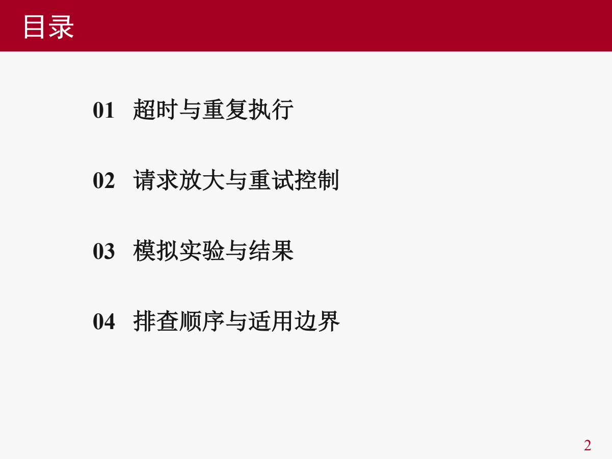</td>
  </tr>
  <tr>
    <td width="50%"></td>
    <td width="50%"></td>
  </tr>
  <tr>
    <td width="50%">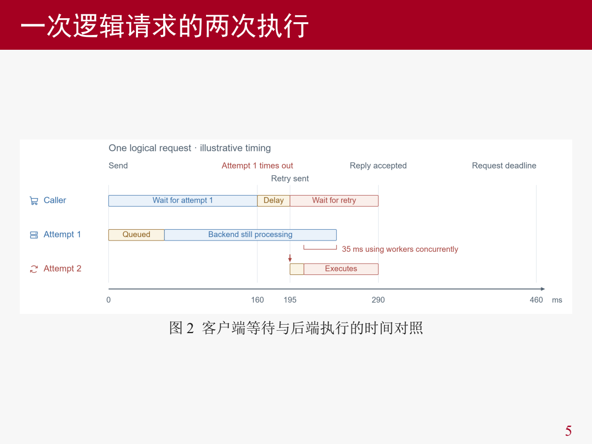</td>
    <td width="50%"></td>
  </tr>
  <tr>
    <td width="50%">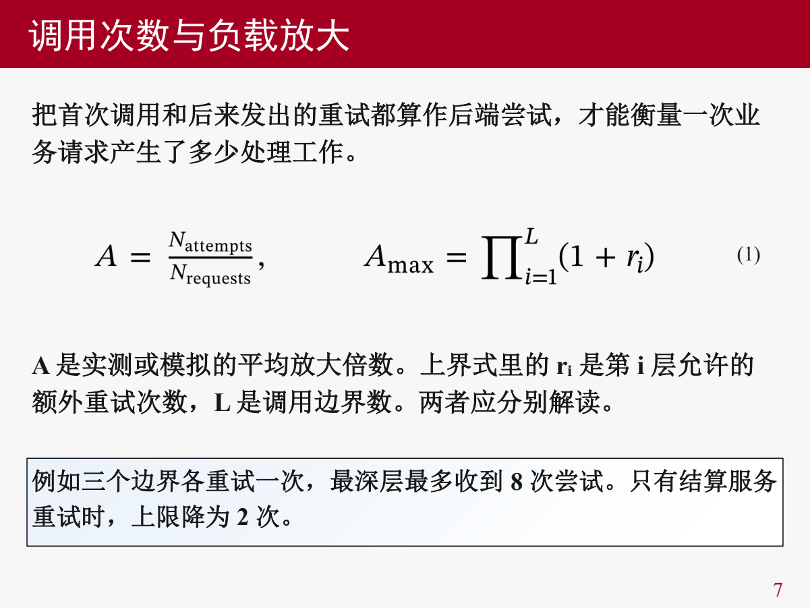</td>
    <td width="50%">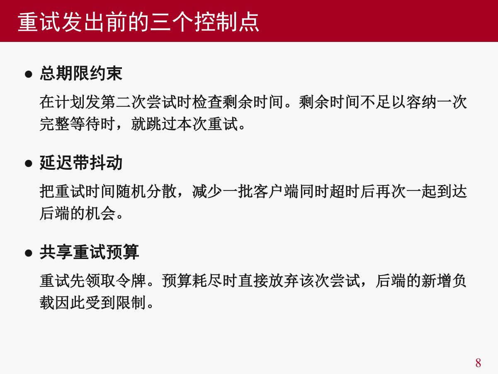</td>
  </tr>
  <tr>
    <td width="50%">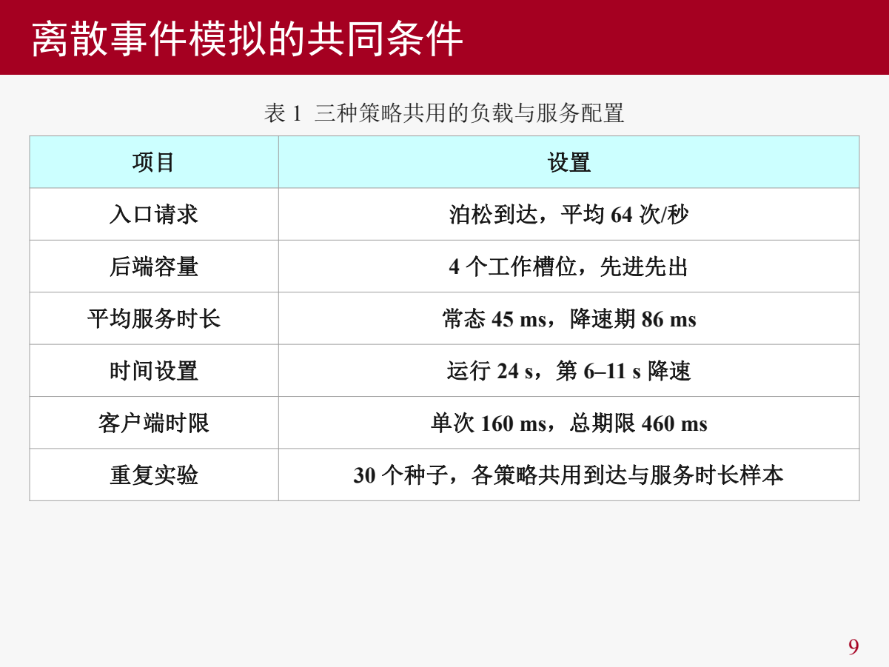</td>
    <td width="50%">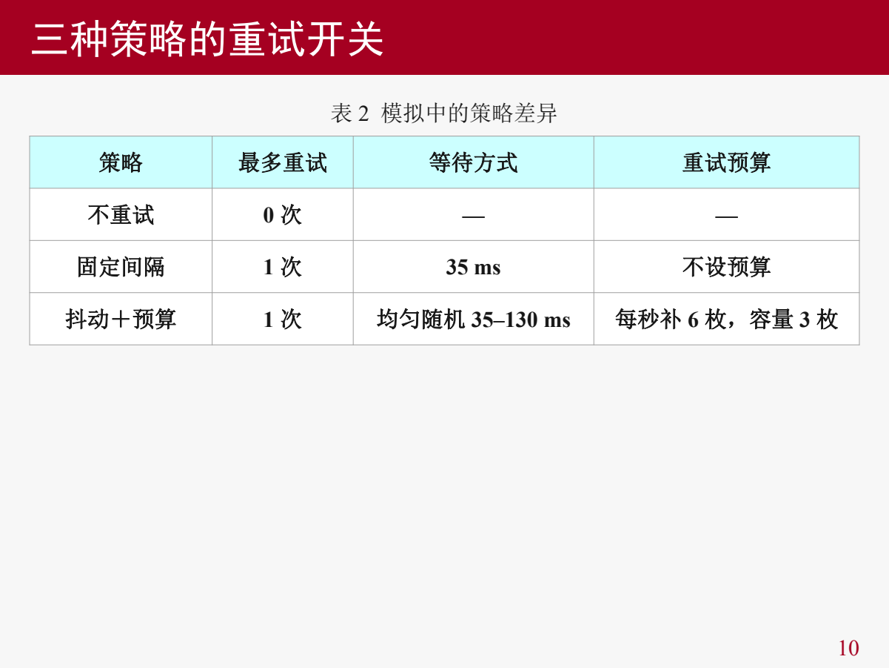</td>
  </tr>
  <tr>
    <td width="50%">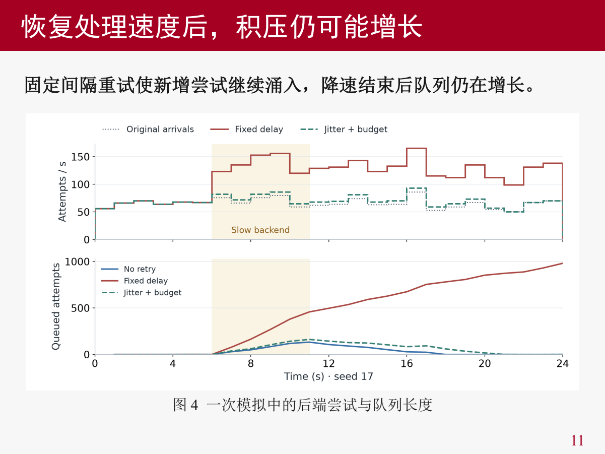</td>
    <td width="50%">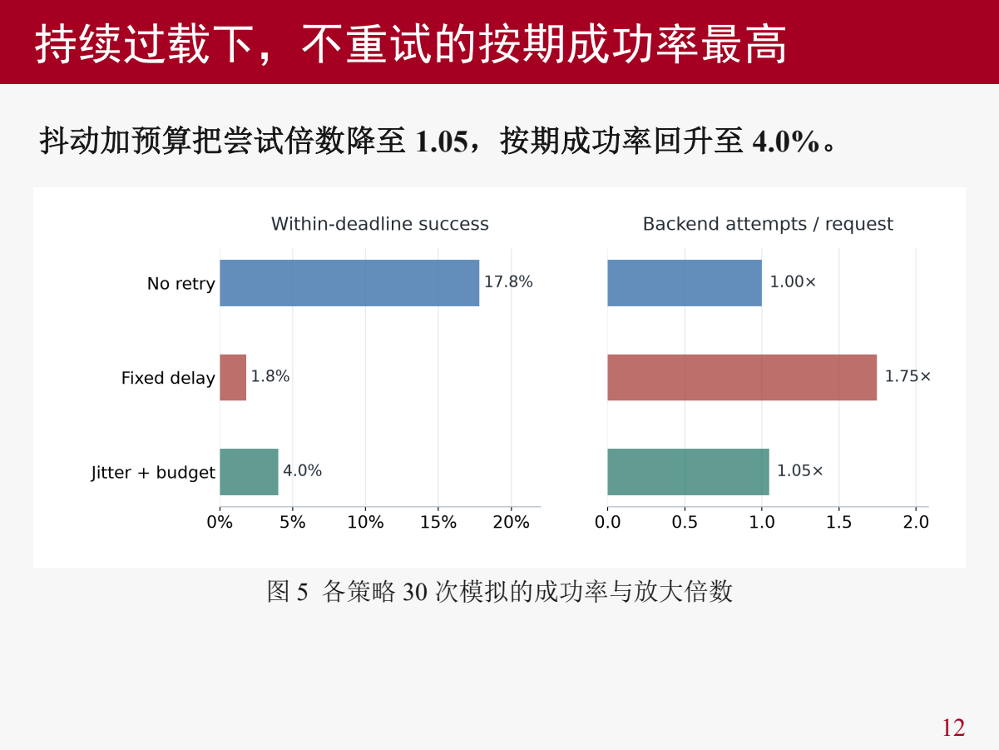</td>
  </tr>
  <tr>
    <td width="50%"></td>
    <td width="50%">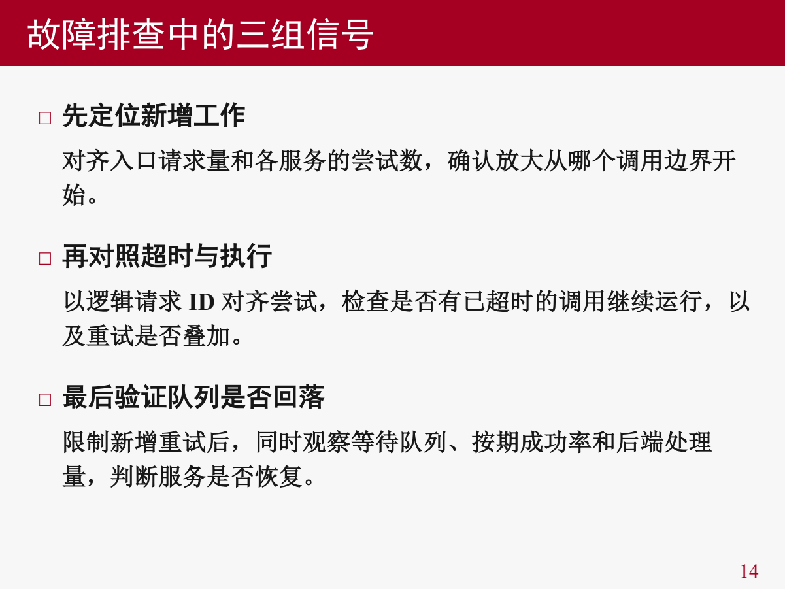</td>
  </tr>
  <tr>
    <td width="50%">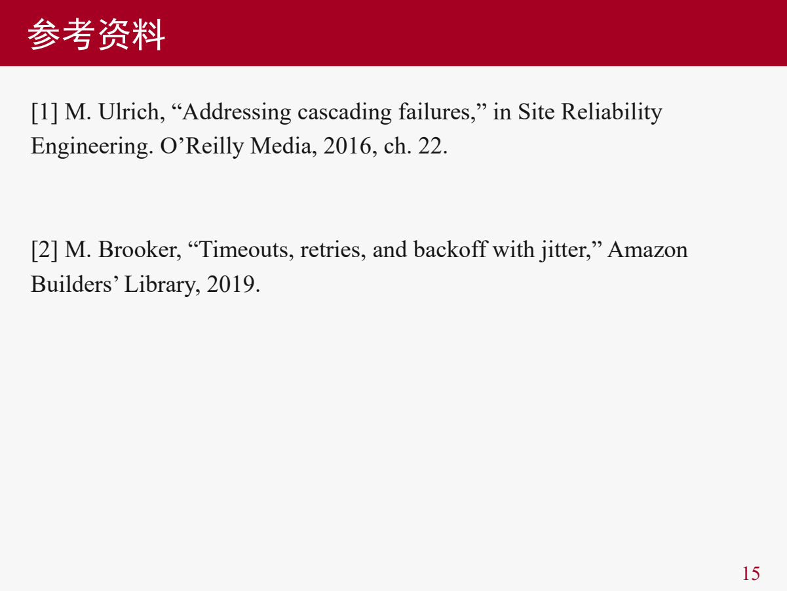</td>
    <td width="50%">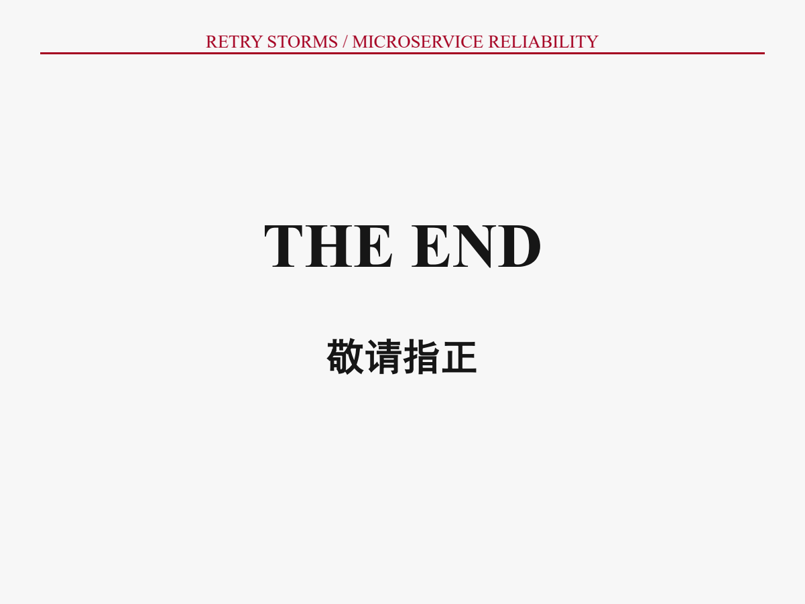</td>
  </tr>
</table>

## Installation

### Choose your agent and scope

Install Git, Python 3.11+, and Codex, Claude Code, or DeepSeek Harness. Clone the entire repository into one of the directories below so that `SKILL.md` sits at the root of `scientific-ppt/`.

| Agent | All projects for your user | Current project | Invoke |
| --- | --- | --- | --- |
| OpenAI Codex | `~/.agents/skills/scientific-ppt/` | `.agents/skills/scientific-ppt/` | `$scientific-ppt` |
| Claude Code | `~/.claude/skills/scientific-ppt/` | `.claude/skills/scientific-ppt/` | `/scientific-ppt` |
| DeepSeek Harness (DSH) | `~/.dsh/skills/scientific-ppt/` | `.dsh/skills/scientific-ppt/` | Ask the agent to use `scientific-ppt` |

Project paths are relative to the target project's root. On Windows, `~` refers to `%USERPROFILE%`. [Codex documentation](https://learn.chatgpt.com/docs/build-skills#where-codex-loads-local-skills) · [Claude Code documentation](https://code.claude.com/docs/en/skills)

### Windows (PowerShell)

This example uses Codex user scope. Pass `.claude/skills` or `.dsh/skills` as the second `Join-Path` argument for Claude Code or DeepSeek Harness. For project scope, run from the target project root and set `$skillsDir` directly to the corresponding `skills` directory in the table.

```powershell
$skillsDir = Join-Path $env:USERPROFILE '.agents/skills'
New-Item -ItemType Directory -Force -Path $skillsDir | Out-Null
git clone 'https://github.com/qmend/scientific-ppt.git' (Join-Path $skillsDir 'scientific-ppt')
Set-Location (Join-Path $skillsDir 'scientific-ppt')
powershell -NoProfile -File scripts/bootstrap.ps1
```

### Linux (Bash)

This example uses Codex user scope. For Claude Code, use `$HOME/.claude/skills`. For DeepSeek Harness, use `$HOME/.dsh/skills`. For project scope, run from the target project root and use the relative path in the table.

```bash
skills_dir="$HOME/.agents/skills"
mkdir -p "$skills_dir"
git clone 'https://github.com/qmend/scientific-ppt.git' "$skills_dir/scientific-ppt"
cd "$skills_dir/scientific-ppt"
python3 -m venv .venv
.venv/bin/python -m pip install -r requirements.lock
.venv/bin/python scripts/scientific_ppt.py doctor
```

After initialization, return to your working project, invoke the Skill in your agent, and attach a paper, dataset, or content brief.

If DeepSeek Harness uses a custom `DSH_HOME`, place the user-scoped Skill under `skills/scientific-ppt/` in that directory. DSH also discovers project and user `.agents/skills/` directories, so it can reuse an existing Codex installation. After initialization, open the target project in Harness and ask it to use `scientific-ppt` with your input. [DeepSeek Harness Skill documentation](https://deepseek-harness.github.io/deepseek-harness/en/reference/subsystems/skills#local-discovery-priority)

## PowerPoint style · Classic academic lecture slides

- The bundled 4:3 PowerPoint master provides cover, content, and closing layouts with a pale background, burgundy title bands, and thin rules on the cover and closing slides. Headings use SimHei and body text uses bold SimSun. Blue and burgundy highlight a few meaningful phrases. [Download the master](assets/template.pptx)
- Full decks include a cover, vertical agenda, separate references page, and closing slide. Figures have captions below, tables have captions above, and equation numbers align to the right.
- Table headers and body cells are bold. Long tables paginate by logical group, fill the available height before the final page, and repeat the header. The final page uses natural row heights.
- Research figures align comparable branches, labels, and ports. Use a wide layout for timelines and a compact layout for layered relationships. On a standalone wide-figure slide, center the figure and caption together vertically. Reuse icons to identify the same service or data across panels. [Figure design guide](references/figure_tools.md)

## Notes

- Actual previews require PowerPoint or LibreOffice. Without a renderer, the deck still exports and the report records `unverified`. End-to-end rendering has been verified on Windows with PowerPoint.
- PowerPoint tables and native charts remain editable. Drawlib figures are inserted as single images, and equations retain their LaTeX sources.
- Inspect the rendered pages, especially equations, arrow routes, and table continuations. Generated work stays in `artifacts/`. The repository tracks the selected showcase files in `examples/`. [Visual QA](references/visual_qa.md) · [Test results](references/test_report.md)

## Skill rules

- **Virtual environments.** Install the project dependencies inside `.venv/` using `requirements.lock`.
- **Figure libraries.** Prefer Drawlib for computer science architecture diagrams, flowcharts, and pipelines. Use Matplotlib, a specialist library, or a native PowerPoint chart for data figures. The optional Drawlib environment uses `requirements-drawlib.lock`. [Figure tool selection](references/figure_tools.md)
- **PowerPoint dependencies.** `python-pptx` builds the PPTX. PowerPoint or LibreOffice renders it. Use `doctor` to check fonts and renderers. [Installation and dependencies](references/installation.md)
- **Workflow.** The agent plans slides in a shared JSON schema. The builder loads the master automatically and lays out and paginates content before the agent reviews the rendered slides. When tokens specify a custom canvas, background, primary color, or base title-band height, the builder draws these elements using those values. Reproducible test inputs are in `tests/fixtures/demo/`. [SKILL.md](SKILL.md) · [Slide schema](references/deck.schema.json)

The code is [MIT licensed](LICENSE). See [third-party notices](THIRD_PARTY_NOTICES.md) for other materials.

## Changelog

### 2026-11-14

- Replaced the showcase with the 16-slide Retry Storm briefing and its PowerPoint-rendered previews.
- Documented stable cover and closing layouts, speaker-note attribution, and figure alignment and aspect-ratio rules.

### 2026-11-13

- Added a 4:3 PowerPoint master and automatic selection of its cover, content, and closing layouts.
- Kept support for custom design tokens and title bands that expand to fit longer headings.
- Updated the Windows and Linux install examples with the repository clone URL.
- Updated the figure workflow to show complex methods through stages, data representations, and feedback paths, with standard flowcharts for procedures.
