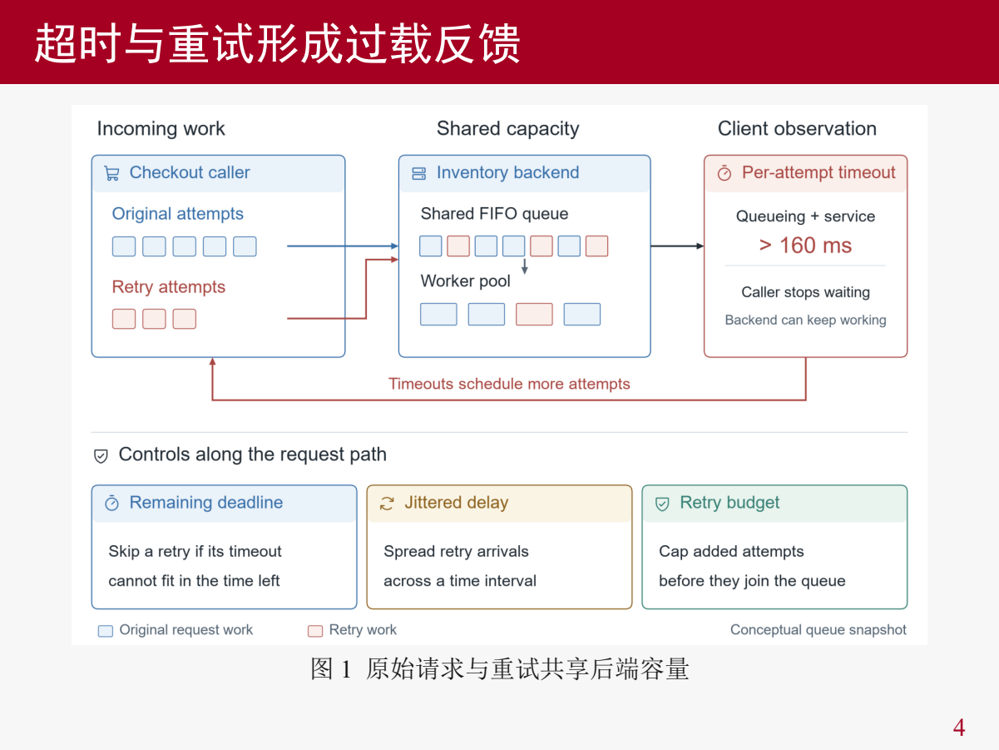
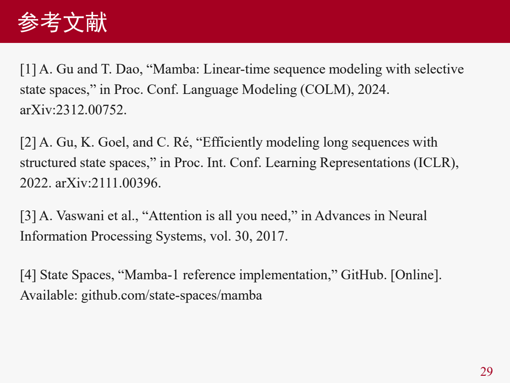

# scientific-ppt

[中文说明](README.md)

## What it is

`scientific-ppt` is an Agent Skill for turning papers, documents, or topics into research and technical PowerPoint presentations. The agent reviews sources and plans the story. Python builds editable slides, paginates long content, and checks the rendered deck.

## Preview

**Codex used `scientific-ppt` to produce this 30-slide presentation on the Mamba architecture.** The deck shows how Codex applied the Skill to Drawlib diagrams, experimental charts, numbered equations, and editable tables with automatic pagination.

[Download the PowerPoint source file](examples/mamba-architecture.pptx) · [Browse all 30 slide previews](examples/previews/)

<table>
  <tr>
    <td></td>
    <td></td>
    <td></td>
    <td></td>
  </tr>
  <tr>
    <td></td>
    <td></td>
    <td></td>
    <td></td>
  </tr>
</table>

## Installation

### Choose your agent and scope

Install Git, Python 3.11+, and Codex, Claude Code, or DeepSeek Harness. Clone the entire repository into one of the directories below so that `SKILL.md` sits at the root of `scientific-ppt/`.

| Agent | All projects for your user | Current project | Invoke |
| --- | --- | --- | --- |
| OpenAI Codex | `~/.agents/skills/scientific-ppt/` | `.agents/skills/scientific-ppt/` | `$scientific-ppt` |
| Claude Code | `~/.claude/skills/scientific-ppt/` | `.claude/skills/scientific-ppt/` | `/scientific-ppt` |
| DeepSeek Harness (DSH) | `~/.dsh/skills/scientific-ppt/` | `.dsh/skills/scientific-ppt/` | Ask the agent to use `scientific-ppt` |

Project paths are relative to the target project's root. On Windows, `~` refers to `%USERPROFILE%`. [Codex documentation](https://learn.chatgpt.com/docs/build-skills#where-codex-loads-local-skills) · [Claude Code documentation](https://code.claude.com/docs/en/skills)

### Windows (PowerShell)

Replace the repository URL. This example uses Codex user scope. Pass `.claude/skills` or `.dsh/skills` as the second `Join-Path` argument for Claude Code or DeepSeek Harness. For project scope, run from the target project root and set `$skillsDir` directly to the corresponding `skills` directory in the table.

```powershell
$skillsDir = Join-Path $env:USERPROFILE '.agents/skills'
New-Item -ItemType Directory -Force -Path $skillsDir | Out-Null
git clone '<repository URL>' (Join-Path $skillsDir 'scientific-ppt')
Set-Location (Join-Path $skillsDir 'scientific-ppt')
powershell -NoProfile -File scripts/bootstrap.ps1
```

### Linux (Bash)

This example uses Codex user scope. For Claude Code, use `$HOME/.claude/skills`. For DeepSeek Harness, use `$HOME/.dsh/skills`. For project scope, run from the target project root and use the relative path in the table.

```bash
skills_dir="$HOME/.agents/skills"
mkdir -p "$skills_dir"
git clone '<repository URL>' "$skills_dir/scientific-ppt"
cd "$skills_dir/scientific-ppt"
python3 -m venv .venv
.venv/bin/python -m pip install -r requirements.lock
.venv/bin/python scripts/scientific_ppt.py doctor
```

After initialization, return to your working project, invoke the Skill in your agent, and attach a paper, dataset, or content brief.

If DeepSeek Harness uses a custom `DSH_HOME`, place the user-scoped Skill under `skills/scientific-ppt/` in that directory. DSH also discovers project and user `.agents/skills/` directories, so it can reuse an existing Codex installation. After initialization, open the target project in Harness and ask it to use `scientific-ppt` with your input. [DeepSeek Harness Skill documentation](https://deepseek-harness.github.io/deepseek-harness/en/reference/subsystems/skills#local-discovery-priority)

## PowerPoint style · Classic academic lecture slides

- The default 4:3 layout uses burgundy title bars, SimHei headings, a pale background, and bold SimSun body text. Blue and burgundy highlight a few meaningful phrases.
- Full decks include a cover, vertical agenda, separate references page, and closing slide. Figures have captions below, tables have captions above, and equation numbers align to the right.
- Table headers and body cells are bold. Long tables paginate by logical group, fill the available height before the final page, and repeat the header. The final page uses natural row heights.
- Architecture diagrams and flowcharts use white nodes with a consistent icon family. [Reference style guide](references/style_guide.md)

## Notes

- Actual previews require PowerPoint or LibreOffice. Without a renderer, the deck still exports and the report records `unverified`. End-to-end rendering has been verified on Windows with PowerPoint.
- PowerPoint tables and native charts remain editable. Drawlib figures are inserted as single images, and equations retain their LaTeX sources.
- Inspect the rendered pages, especially equations, arrow routes, and table continuations. Generated work stays in `artifacts/`. The repository tracks the selected showcase files in `examples/`. [Visual QA](references/visual_qa.md) · [Test results](references/test_report.md)

## Skill rules

- **Virtual environments.** Install the project dependencies inside `.venv/` using `requirements.lock`.
- **Figure libraries.** Prefer Drawlib for computer science architecture diagrams, flowcharts, and pipelines. Use Matplotlib, a specialist library, or a native PowerPoint chart for data figures. The optional Drawlib environment uses `requirements-drawlib.lock`. [Figure tool selection](references/figure_tools.md)
- **PowerPoint dependencies.** `python-pptx` builds the PPTX. PowerPoint or LibreOffice renders it. Use `doctor` to check fonts and renderers. [Installation and dependencies](references/installation.md)
- **Workflow.** The agent plans slides in a shared JSON schema, then checks the rendered output. Reproducible test inputs are in `tests/fixtures/demo/`. [SKILL.md](SKILL.md) · [Slide schema](references/deck.schema.json)

The code is [MIT licensed](LICENSE). See [third-party notices](THIRD_PARTY_NOTICES.md) for other materials.
